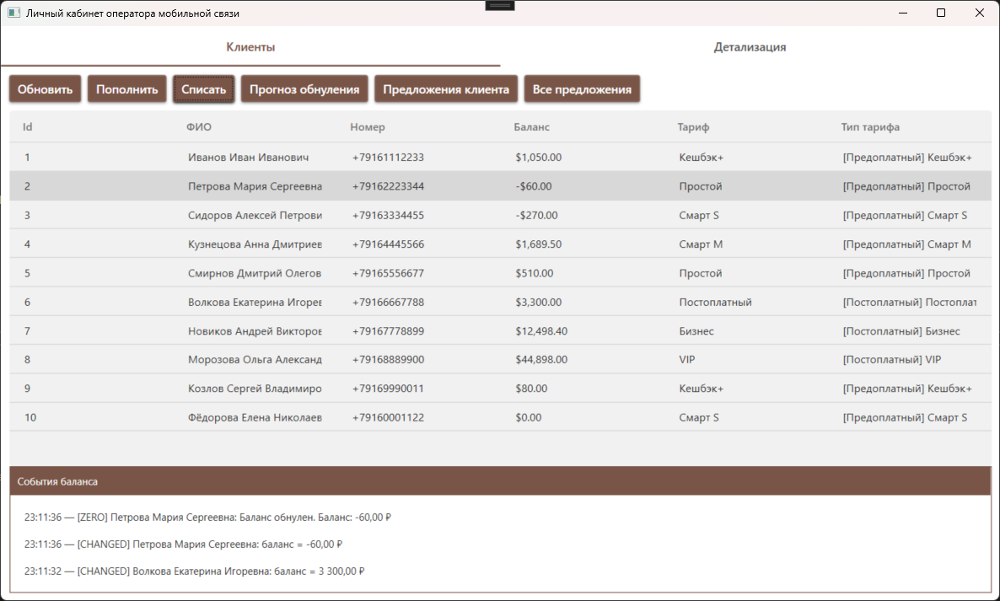
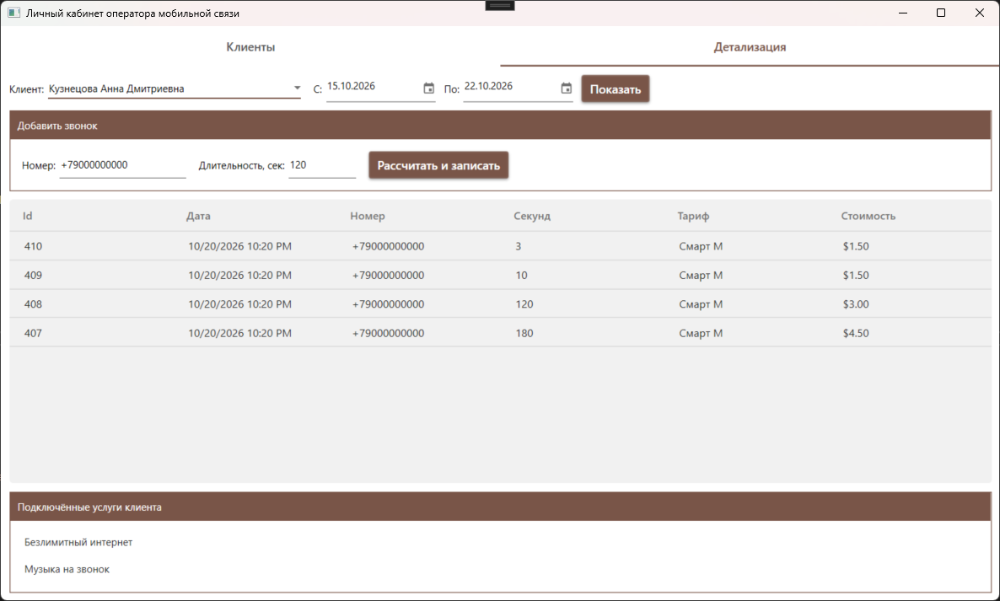

# Mobile Operator: Личный кабинет клиента

**Курсовая работа по дисциплине «Основы программирования»**  

## О проекте

Данный репозиторий содержит решение для управления клиентской базой оператора мобильной связи. 
Проект состоит из двух частей:
1. **`MobileOperatorClassLibrary`** — библиотека классов (ядро), инкапсулирующая бизнес-логику предметной области.
2. **`MobileOperatorDesktop`** — десктопное WPF-приложение (личный кабинет), демонстрирующее использование библиотеки.

### Ключевые возможности
*   **Управление балансом:** пополнение и списание средств с генерацией событий (`OnBalanceLow`, `OnBalanceZero`).
*   **Детализация расходов:** история звонков с расчётом стоимости через интерфейс `IRateCalculator`.
*   **Прогнозирование:** расчёт предполагаемой даты обнуления баланса на основе истории трат (`BalancePredictor`).
*   **Автогенерация предложений:** формирование персональных предложений клиентам при падении баланса (`OfferGenerator`) с сохранением в БД.
*   **Иерархия тарифов:** поддержка предоплатных и постоплатных тарифов с разными правилами расчёта штрафов.

## 🛠 Технологический стек
*   **Язык:** C# 12 / .NET 8
*   **UI:** WPF (Windows Presentation Foundation)
*   **БД:** PostgreSQL 16
*   **ORM / Работа с БД:** Dapper, Npgsql
*   **UI-библиотека:** MaterialDesignInXAML

## Архитектура и реализация ООП

В библиотеке классов реализованы все ключевые механизмы объектно-ориентированного программирования:
*   **Наследование:** `Tariff` → `PrepaidTariff`, `PostpaidTariff`; `Detail` → `CallDetail`, `InternetDetail`, `SmsDetail`.
*   **Переопределение:** расчёт абонентской платы и штрафов в наследниках тарифов.
*   **Перегрузка:** методы `CalculatePenalty(decimal, bool)`, `PredictZeroDate(Client, int)`.
*   **События:** `OnBalanceChanged`, `OnBalanceLow`, `OnBalanceZero` в классе `Client`.
*   **Агрегация и композиция:** `Client` агрегирует `Tariff` и композирует список `Service`.
*   **Интерфейсы:** `IRateCalculator` (паттерн «Стратегия»), `IPredictable`, `IClientRepository`, `IOfferRepository`.

##  Установка и запуск

### Предварительные требования
*   [.NET 8 SDK](https://dotnet.microsoft.com/download/dotnet/8.0)
*   [PostgreSQL](https://www.postgresql.org/download/) (версия 14+)
*   Visual Studio 2022 (с установленным компонентом «Разработка классических приложений .NET»)

### Шаг 1. Клонирование репозитория
```bash
git clone https://github.com/ваш-username/mobile-operator-solution.git
cd mobile-operator-solution
```

### Шаг 2. Настройка базы данных
1. Создайте базу данных `mobile_operator` в PostgreSQL.
2. Выполните SQL-скрипты из папки `Database/`:
   *   `01_schema.sql` — создание таблиц и связей.
   *   `02_seed.sql` — заполнение тестовыми данными (тарифы, услуги, клиенты, звонки).

### Шаг 3. Настройка строки подключения
В файле `MobileOperatorDesktop/appsettings.json` укажите ваши данные для подключения к PostgreSQL:

```json
{
  "ConnectionStrings": {
    "MobileOperatorDb": "Host=localhost;Port=5432;Database=mobile_operator;Username=postgres;Password=ВАШ_ПАРОЛЬ"
  }
}
```

### Шаг 4. Запуск
1. Откройте файл `MobileOperator.sln` в Visual Studio.
2. Установите проект `MobileOperatorDesktop` как автозапускаемый (Set as Startup Project).
3. Нажмите `F5` или кнопку «Пуск».

## Скриншоты

| Вкладка «Клиенты» | Вкладка «Детализация» |
| :---: | :---: |
|  |  |
| *Управление балансом, лог событий и таблица клиентов* | *История звонков, добавление новых записей и подключённые услуги* |

## Структура проекта

    ├── MobileOperatorClassLibrary/   # Ядро (библиотека классов)
    │   ├── Data/                     # Репозитории (Dapper), DTO
    │   ├── Domain/                   # Бизнес-сервисы (Predictor, Generator)
    │   ├── Entities/                 # Сущности (Client, Tariff, Detail...)
    │   ├── EventArguments/           # Аргументы событий
    │   └── Interfaces/               # Интерфейсы
    ├── MobileOperatorDesktop/        # WPF-приложение (UI)
    │   ├── Views/                    # Страницы (UserControl)
    │   ├── App.xaml                  # Точка входа, DI-контейнер (упрощённый)
    │   └── appsettings.json          # Конфигурация
    ├── Database/                     # SQL-скрипты
    ├── docs/                         # Изображения для документации
    └── MobileOperator.sln            # Решение

## Автор
**Кудринский Артем Алексеевич**   
*2026 г.*

---
*Проект разработан в рамках курсовой работы. Библиотека классов не зависит от UI-фреймворка и может быть использована в веб- или консольных приложениях без изменения исходного кода.*
